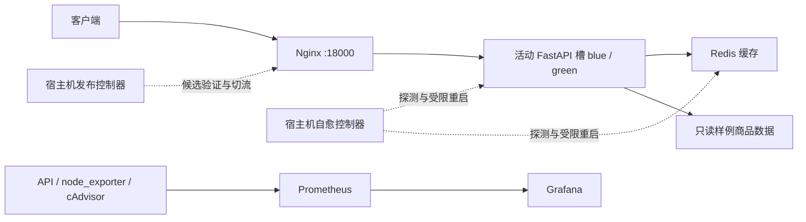

# SRE Failure Lab｜SRE 故障演练实验室

一个面向 SRE 学习与实践的单机实验项目：以 FastAPI 商品查询和 Redis 缓存为业务，练习故障注入、资源观测、真实自愈、蓝绿发布和回滚。提供 Docker Compose 教学环境，以及由 Linux systemd 统一管理的真实运行环境。

## 能做什么

- **业务与缓存**：商品查询、缓存命中与降级、JSON 请求日志、请求 ID 和版本标记。
- **故障演练**：注入延迟、错误和 CPU 压力，在持续流量下观察业务与资源变化。
- **真实自愈**：探测 Redis 和活动 API，执行受限容器重启；具备连续失败阈值、冷却、恢复预算和后续验证。商品 429 作为过载记录，不触发无意义重启。
- **资源可观测**：Prometheus 与 Grafana 展示业务、缓存、CPU、内存、文件系统及磁盘指标；node_exporter 采集主机指标，cAdvisor 采集容器 CPU/内存。
- **可控发布与回滚**：固定镜像 ID、候选检查、Nginx 切流、发布后观察、失败自动回退及手动回滚。
- **统一服务管理**：一个 `sre-lab` 服务管理容器与自愈进程，支持启停、重启和开机配置，保留发布记录与恢复预算。

## 架构

真实运行模式中的流量和控制关系：



## 选择运行方式

| 模式 | 配置 / 入口 | 适合做什么 |
| --- | --- | --- |
| 教学环境 | `compose.yaml`、`make`、`scripts/lab.py` | 快速体验商品服务、缓存、故障注入和模拟控制流程 |
| Linux 真实环境 | `compose.runtime.yaml`、`ops`、systemd | 真正重启容器、切换版本、回滚及统一管理服务 |
| 组件模拟 | `python -m scripts.simulate` | 使用 fake Redis 验证模拟逻辑，不操作真实容器 |

`/console` 中的自愈与发布面板，以及 `/lab/healing`、`/lab/deployment`，展示的是教学模拟器。真实控制器的状态由 `ops` 和 `runtime/` 记录提供。两种 Compose 环境使用部分相同端口，默认配置不要在同一机器同时启动。

## 快速开始：教学环境

准备 Docker Engine、Docker Compose 插件和 Python 3。在克隆后的项目根目录执行：

```bash
python3 scripts/init_env.py
docker compose up --build -d --wait
curl -i http://127.0.0.1:8000/products/1
```

初始化会生成本机 `.env`，已有配置不会被覆盖。首次构建和拉取镜像需要网络。重复查询商品可观察 `X-Cache: MISS/HIT`；请求日志带 `X-Request-ID`。

- 商品接口：<http://127.0.0.1:8000/products/1>
- API 文档：<http://127.0.0.1:8000/docs>
- 教学控制台：<http://127.0.0.1:8000/console>
- Grafana：<http://127.0.0.1:3000>，用户名 `admin`，密码在本机 `.env`。

安装了 Make 后，可执行 `make smoke` 检查业务、`make traffic` 产生流量，再按 [教学主线](docs/learning-path.md) 和 [CPU 实验](docs/cpu-lab.md) 演练。停止教学环境使用 `docker compose --profile traffic down`；不要将这些命令用于真实运行环境。

## Linux 真实环境

需要使用 systemd 的 Linux、Docker Engine/Compose、宿主机 Python 3.9+ 和管理员权限。将源码放到新的 `/opt/sre-failure-lab`，在 root 会话中首次初始化；已有部署不要重新 init：

```bash
cd /opt/sre-failure-lab
python3 scripts/init_env.py
LAB_DOCKER_GATEWAY=$(docker network inspect bridge --format '{{(index .IPAM.Config 0).Gateway}}')
printf '\nMETRICS_HOST_GATEWAY=%s\nRUNTIME_BIND_HOST=127.0.0.1\n' "$LAB_DOCKER_GATEWAY" >> .env
docker compose -f compose.runtime.yaml pull redis edge prometheus grafana node-exporter cadvisor
docker build --build-arg APP_VERSION=0.3.0 -t sre-lab-api:0.3.0 .
python3 -m ops.deploy init --image sre-lab-api:0.3.0
bash scripts/install_systemd.sh
python3 -m ops.stack status
curl -fsS http://127.0.0.1:18000/products/1
```

此示例只绑定本机访问；需要从受信实验网络访问时，调整 `.env` 的 `RUNTIME_BIND_HOST` 和对应防火墙规则。首次初始化只有 blue 槽，发布下一版后形成双槽。详细步骤见 [真实部署](docs/real-deployment.md)、[统一 systemd 管理](docs/systemd.md) 和 [配置与认证](docs/security.md)。

日常管理与排查：

```bash
systemctl start sre-lab
systemctl stop sre-lab
systemctl restart sre-lab
systemctl status sre-lab --no-pager
python3 -m ops.stack status
python3 -m ops.heal status
journalctl -u sre-lab -u sre-lab-healer -n 100 --no-pager
```

安装器启用主服务的开机启动；自愈作为子服务运行。停止时先停自愈，再停容器。`active (exited)` 只表示启动步骤完成，持续健康需结合容器、HTTP 和监控判断。启动恢复已保存的镜像与槽，不自动构建、拉取、发布或回滚。

后续发布与手动回滚示例：

```bash
docker build --build-arg APP_VERSION=0.3.1 -t sre-lab-api:0.3.1 .
python3 -m ops.deploy deploy --image sre-lab-api:0.3.1 --observe-seconds 30
python3 -m ops.deploy rollback
```

发布、自愈和整套启停共用操作锁，不要并行发起发布和服务重启。发布中断后的非 idle 状态需要人工协调；失败清理不会删除发布记录或监控卷。

## 开发与测试

应用开发使用 Python 3.12、uv；控制台测试另需 Node.js。宿主机 `ops` 使用 Python 3.9+ 标准库。

```bash
uv sync --locked --python 3.12
uv run --locked pytest -q
uv run --locked ruff check .
node --test tests/console.test.cjs
uv run --locked python -m scripts.simulate
```

2026-11-16 全套 Python 测试为 **244 passed、0 skipped**，包含真实 Redis 集成；Ruff 通过。普通运行若未设置 `TEST_REDIS_SERVER`，真实 Redis 测试会跳过。安装本机 `redis-server` 后显式启用：

```bash
TEST_REDIS_SERVER="$(command -v redis-server)" uv run --locked pytest -q
```

源码测试、组件模拟和 Linux 实机验收是不同层次，不能互相替代。`uv.lock` 锁定开发依赖；Docker 构建使用带哈希的 `requirements.txt`。

## 已验证的结果与边界

Linux 实机已完成 Redis/API 停止后的真实自愈、正常发布、手动回滚、切流故障自动回滚，以及 systemd 整套启停和自愈进程异常重启。持续流量复测记录了 3,495 次请求；一次自愈验收中 Redis 恢复用时约 21 秒，API 约 25 秒，这些是实验观测值，不是恢复时间承诺。

这是单机、两个 API 槽、只读样例业务的实验项目。它不提供跨主机高可用、数据库迁移回滚或无限历史版本恢复；自动恢复范围限于 Redis 与活动 API，不能修复宿主机故障、磁盘满或代码缺陷。Redis 未配置持久化；主机/容器指标缺失不能解释为资源使用量为零。

开机启动配置已核实，**实际重启虚拟机后的恢复尚未实测**；全新机器的离线安装也尚未完成现场验收。既有内网机器地址仅用于历史记录，不是公共演示服务。

## 离线安装包

本地已制作约 **706 MB** 的 Linux ARM64 `tar.gz` 包，包含源码、统一服务配置和八个 Docker 镜像。它不在 Git 仓库中，目前也未发布为 GitHub Release；克隆仓库不会获得这些镜像。新机器安装步骤与前提见 [离线包使用说明](离线包使用说明.md)，检查结果见 [离线交付校验](docs/offline-package-validation.md)。该包不包含现有凭据或监控数据备份。

## 进一步阅读

- 运行机制：[真实自愈](docs/real-healing.md)、[真实发布与回滚](docs/real-deployment.md)、[systemd 管理](docs/systemd.md)。
- 演练与排查：[教学主线](docs/learning-path.md)、[故障排查手册](docs/runbooks.md)、[持续流量验收方法](docs/traffic-testing.md)、[SLO 与报告](docs/slo-reports.md)。
- 历史实机证据：[首次运行验收](docs/validation-137.md)、[完整流量验收](docs/traffic-validation-137.md)、[systemd 验收](docs/systemd-validation-137.md)。

早期 `docs/validation.md`、规划及模拟记录反映当时的验证范围；判断真实运行能力时，请结合上述实机记录及其明确列出的限制。
