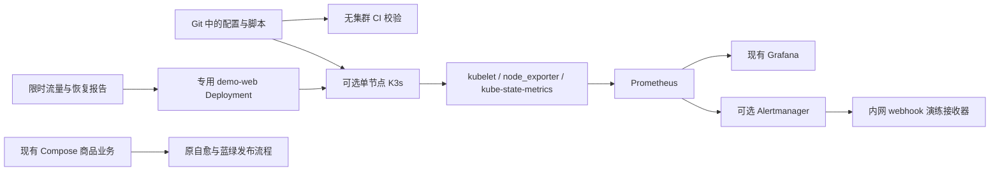

# 没有集群时，怎样准备 Kubernetes 实验

当前阶段按“还没有可用 Kubernetes 集群”设计。先在本机和 GitHub Actions 验证配置与程序行为；以后在一台独立 Linux 实验虚拟机上完成安装、告警、故障演示和重启验收。日常使用原 Compose 实验室不依赖 Kubernetes。

`docs/kubernetes-validation-137.md` 是 v0.4.0 阶段的 ARM64 历史记录，不代表当前机器在线，也不代表本次新增的告警、重启与演示流程已经在集群运行成功。**v0.5.0 源码包已包含本页、三个操作手册及准备、告警、演示程序**；本轮仅完成本地与配置验证，新增功能的集群现场结果仍待取得。该包需要联网安装，不包含 Docker 镜像或开发依赖。

## 最终要验证的三件事

| 目标 | 设计与交付 | 真正通过的条件 |
| --- | --- | --- |
| 新机器可安装，重启可恢复 | 只读主机预检、固定版本安装器、重启前后证据脚本 | 同一主机与集群、boot ID 确实变化、关键服务和工作负载恢复、监控 PVC 身份保留 |
| 发现故障并收到恢复通知 | Prometheus 规则 → Alertmanager → 内网 webhook 接收器 | 同一演练 run ID 的 firing 与 resolved 均到达；不是只看规则文件存在 |
| 可以重复演示并解释结果 | 计划模式、精确 context、演示资源身份检查、限时流量与 Pod 删除 | 记录新旧 Pod UID、恢复耗时、请求总数与错误数、延迟；失败也保存报告 |

这些目标是后续现场验收标准，不是已有测试成绩。单节点实验无法在整台机器断电时由另一节点接管；本机告警组件也可能一起中断，需要外部探针才能发现整机失联。

## 结构与操作范围



- **`sre-k8s-demo`**：仅运行演示 Web 工作负载，故障脚本只允许对经身份核验的单个演示 Pod 操作。
- **`sre-monitoring`**：监控组件、规则、可选通知接收器；默认不暴露到公网。
- **原 Compose 环境**：FastAPI/Redis、自愈预算、蓝绿发布状态和监控卷保留独立生命周期。
- **凭据与证据**：kubeconfig 不进入 Git；原始报告放 `reports/`，含主机或集群标识的报告保持本地，公开前人工检查。

当前通知接收器用于实验验收；事件存于有界内存，不是可靠的外部值班通知服务，也不是长期事件数据库。短信、邮件或聊天平台对接需要另外配置接收端与私密凭据。

## 现在可以做的验证

开发环境使用 Python 3.12 和 uv：

```bash
uv sync --locked --python 3.12
uv run --locked pytest -q
uv run --locked ruff check .
python3 scripts/check_k8s_host.py --plan
python3 scripts/demo_k8s.py --plan
python3 scripts/accept_k8s_alerts.py --plan
```

计划模式不连接集群，不制造故障，其结果必须是 `not_tested`。单元测试中的虚拟主机、模拟命令和本地 HTTP 接收器验证的是程序逻辑，不是 Kubernetes 实机行为。

另外准备 Helm **4.3.2**、promtool **3.16.0**、amtool **0.35.0** 和官方 `kube-prometheus-stack-93.3.1.tgz`，即可执行完整配置校验：

```bash
uv run --locked python scripts/validate_k8s.py \
  --helm /path/to/helm \
  --promtool /path/to/promtool \
  --amtool /path/to/amtool \
  --chart /path/to/kube-prometheus-stack-93.3.1.tgz
```

校验器检查固定 chart 摘要，使用空 kubeconfig，执行基础与告警两种配置的 Helm lint/客户端模板渲染，检查 Prometheus 的资源选择器，并运行 Prometheus 规则语法和时间序列单测、Alertmanager 配置与路由测试。它不会调用 kubectl、apply、Helm install 或连接 API Server。首次取得工具/依赖需要联网，已有工具后校验过程无需集群。

GitHub Actions 的 `Kubernetes configuration (no cluster)` 任务会自动下载并核对固定摘要后执行同样检查，输出 `kubernetes-configuration-report` 构件。报告中 `scope=configuration_only`、`live_cluster=not_tested` 不得替换成现场通过。

Helm 的本地渲染不验证节点资源、镜像可拉取性、集群 admission 策略、实际 RBAC、网络连通性或调度；这些必须在后续现场补测。参见 [Helm 客户端模板说明](https://docs.helm.sh/docs/helm/helm_template/) 和 [Prometheus 规则单测说明](https://prometheus.io/docs/prometheus/latest/configuration/unit_testing_rules/)。

本轮已经执行的检查与未验证范围见 [本地验证记录](kubernetes-readiness-validation.md)。

## 以后有集群时的顺序

1. **准备独立实验机**：预检 CPU、内存、磁盘、时钟、端口与工具，确认安装范围。按 [安装与重启验收](kubernetes-installation-acceptance.md) 安装基础模块。
2. **先确认监控有真实数据**：Node Ready、工作负载就绪、PVC Bound、Prometheus 目标 UP、Grafana 查询成功，才进入故障实验。
3. **启用可选告警模块**：按 [告警处理与验收](kubernetes-alerting.md) 增加 Alertmanager 和内网接收器，验证 firing → resolved。
4. **演示一次受控故障**：按 [十分钟演示](kubernetes-demo.md) 运行持续流量，删除专用 Pod，记录实际损失和恢复时间。
5. **安排一次明确的重启窗口**：保存 before 证据、手动重启、执行 after；未重启、换了一台机器或替换了集群都不能算通过。

安装、故障注入、发布、服务重启应依次执行；不要在演练中同时更新 Deployment、Helm release 或手工修改待核验对象。没有集群时，在前面的本地检查阶段停止即可。

## 能用于简历的结论

完成本地/CI 后可描述为“设计并实现 Kubernetes 监控、告警验收和受控演练流程，配置及脚本通过自动化检查”。只有取得后续现场报告，才补充实际恢复耗时、故障期间错误率、通知到达与整机重启恢复结果。
